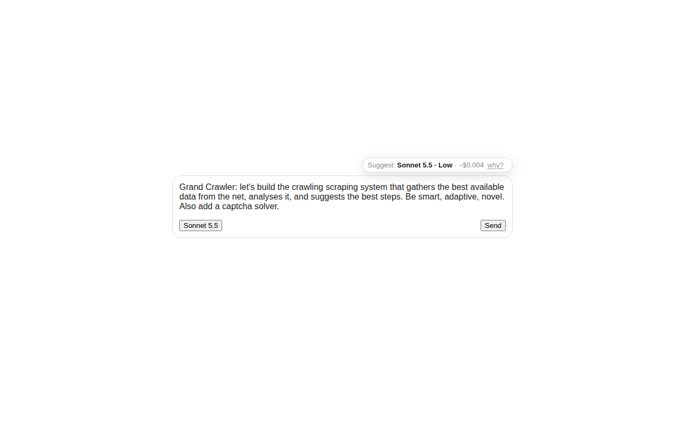
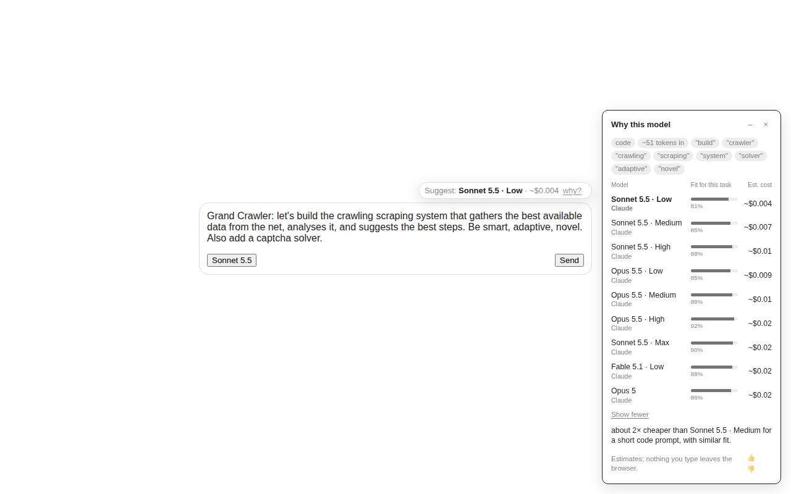

# Εὐβουλία

*Euboulia*: good counsel. A browser extension that watches the prompt you are typing on any LLM chat site and suggests the model that gives the best value for that task, with the cost next to it and a one-click "why?".

```
claude.ai / chatgpt.com / gemini.google.com / grok.com / perplexity.ai / chat.mistral.ai /
chat.deepseek.com / copilot.microsoft.com / poe.com / openrouter.ai / your own Open WebUI
        │  you type…
        ▼
  [ Suggest: Haiku 5.5 · included (Pro) · why? ]      ← badge next to the composer
                                                        ← "why?" opens a small cloud in the
                                                           blank right margin (never over content)
```

Nothing you type leaves the browser. The classifier, the scoring and the catalog all run inside the extension; the only network call is a daily download of the catalog JSON, and only if you configure a URL. See [PRIVACY.md](PRIVACY.md) and [SECURITY.md](SECURITY.md).




## What it does

1. **Finds the chat UI.** Per-site adapters for Claude, ChatGPT and Gemini; experimental adapters for Grok, Perplexity, Le Chat, DeepSeek, Copilot, Poe and OpenRouter (selectors not yet verified on a signed-in session; a catalog update can fix them without a release); an Open WebUI adapter that recognises the app on any host; and a generic adapter for other self-hosted UIs. It finds every prompt composer on the page (Poe's compare mode gets one badge per pane), the model currently selected in the picker, and attached images or files. When you open the site's model picker it also notes which models the site really offers you, so a model missing from the bundled plan table still counts as included.
2. **Reads the prompt as you type** (after 400 ms of idle). A keyword and regex classifier (the same signals as the [Trioditis](https://github.com/alexb-joat/trioditis) router) labels the task: code, reasoning, writing, quick chat, summarising, translation, data work, image understanding, long context. It also notices sensitive data (emails, keys, card numbers) without ever storing the matched text.
3. **Scores the models the site offers.** Fit per task type comes from the catalog; cost is estimated from the prompt size and the model's API price, or shown as "included" when you told it which plan you have. Your preference slider (best quality … cheapest) sets the balance. Custom rules can prefer or exclude models.
4. **Shows the pick** in a badge styled from the site's own font and colours. "why?" opens the explanation: task, signals, the top three with fit and cost, and the reason the winner won. If another service you enabled would be clearly better value, it says so.
5. **Learns locally.** Thumbs up or down, and whether you followed the suggestion when you hit send, are stored in the browser only. When you keep overriding a suggestion with the same model for a task on a site (three or more times, most of the time), that model gets a small nudge and the explanation says "you usually pick X for this"; three net thumbs-downs nudge a model the other way. Export or clear the history on the options page.

## Install (unpacked, for now)

```bash
npm install
npm run build          # dist/chrome and dist/firefox
```

- Chrome, Edge, Brave: open `chrome://extensions`, enable Developer mode, "Load unpacked", pick `dist/chrome`.
- Firefox: `npm run run:ff` (temporary add-on through web-ext), or `about:debugging` → "Load Temporary Add-on" → `dist/firefox/manifest.json`.

The manifest's host permissions are generated from the hosts in `src/catalog/services.json`, so adding a site means adding it there (plus an adapter under `src/sites`).

Then open the extension's options page, set your plan on each service and move the slider.

## Catalog

`src/catalog/catalog.json` is the data contract: services (hosts, selectors, plans, picker labels) and models (strengths per task, prices, context, capabilities, sources with dates). Selectors live in the catalog on purpose: when a site redesigns its composer, a new catalog fixes it without an extension release.

- `npm run catalog:build` regenerates the bundled file from `src/catalog/services.json` plus the OpenRouter models API (prices, context, capabilities, benchmark indexes mapped to initial strengths); `--from models.json` uses a saved copy of that API response instead of fetching.
- Each service in `services.json` carries a `_verified` note saying which selectors were read from the live site and when. Sites behind a sign-in wall (Claude, DeepSeek, Copilot, Poe) still have best-guess selectors; the catalog can patch them later without a release.
- `npm run catalog:validate` runs the same validation the extension applies to a downloaded catalog.
- A separate crawler project will publish a richer catalog to a static URL; paste it into the options page.

## Development

```bash
npm run typecheck
npm test                     # vitest: analyser, scoring, learning, catalog, DOM fixtures
npm run test:e2e             # Playwright + Chromium with the unpacked extension on fixture pages
npm run test:ff              # Firefox: temporary add-on through geckodriver on the same fixture page
npm run build:dev && npm run lint:ff
npm run watch                # rebuild on change
```

`test:ff` needs a Firefox binary and geckodriver. It picks Playwright's Firefox (`npx playwright install firefox`) or `firefox` on PATH, and `geckodriver` on PATH or `~/.cache/euboulia/geckodriver`; override with `FIREFOX_BIN` and `GECKODRIVER`. A snap-packaged geckodriver cannot see binaries outside its snap: use the upstream release.

Fixtures under `tests/fixtures/sites` are trimmed composer regions with a capture date and no personal data. To capture a fresh one from a logged-in session:

```bash
npm run fixture -- claude                     # opens Chromium with a profile under ~/.cache/euboulia; log in, the capture runs when the composer appears
npm run fixture -- chatgpt --cdp http://127.0.0.1:9222   # or attach to your own Chrome started with --remote-debugging-port=9222
```

The script keeps structure, ids, classes, roles and short control labels, and strips conversation text, image sources, scripts, styles, links and anything that looks like a secret.

## Layout

```
src/analyser    classify, sensitive, cost, score, decide, explain, learn  (pure, unit-tested)
src/catalog     catalog.json, schema validation, alias resolution
src/sites       adapter interface, one adapter per site, openwebui, generic
src/content     registry (SPA survival), watcher, badge, cloud, placement, theme
src/background  catalog refresh (alarms + ETag), self-hosted site registration
src/options     settings page
```

## Security and privacy

- No runtime dependencies, no remote code, no `eval`, no HTML injection; the bundles are unminified.
- `tests/unit/no-network.test.ts` fails if the content or options bundle gains any network API; the Chromium smoke asserts no request leaves the page.
- Dev dependencies pinned; GitHub Actions pinned by SHA with read-only permissions; CodeQL and dependency review on pull requests.
- Vulnerability reports: see [SECURITY.md](SECURITY.md).

## Status

Milestones 1 and 2 are done (ten sites plus Open WebUI and generic; badge; cloud; options; picker observation; Firefox and Chromium smokes) and the local-learning part of milestone 3. Still open: real-session selector checks on the sites behind sign-in walls, the optional click-through that switches the site's model for you, and pointing the catalog URL at the crawler's published file.

MIT licensed.
