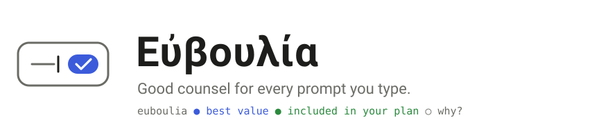
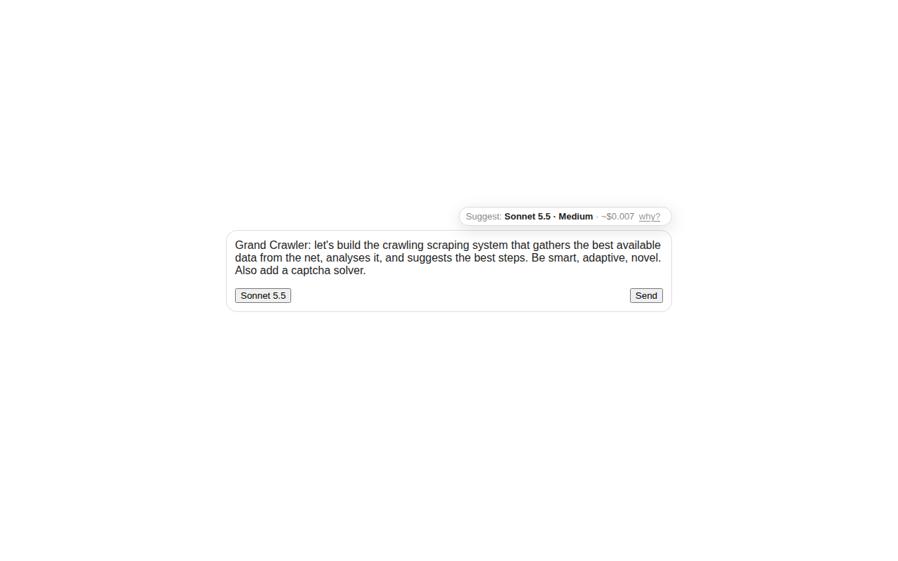
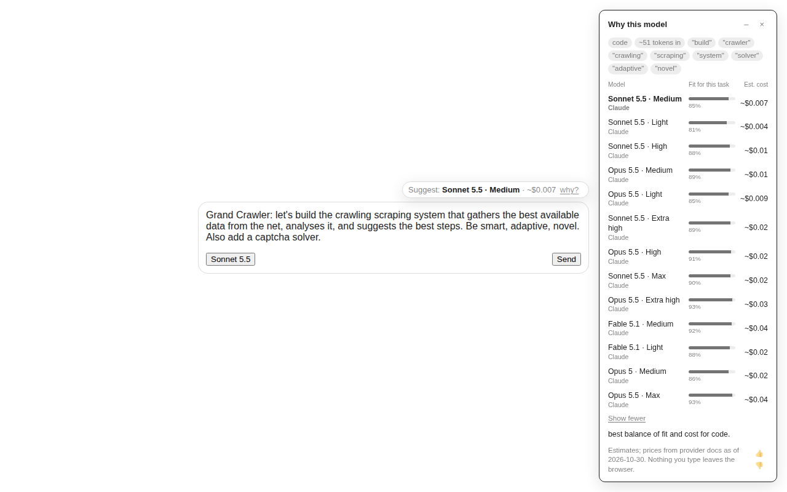

<div align="center">

<picture>
  <source media="(prefers-color-scheme: dark)" srcset="docs/img/banner-dark.svg">
  
</picture>

**A browser extension that suggests the best-value model for the prompt you are typing, on any LLM chat site.** A badge next to the composer names the model, shows the cost (or "included" in your plan) and answers "why?" in one click. Nothing you type leaves the browser.

[](https://github.com/alexb-joat/euboulia/actions/workflows/ci.yml)
[](https://github.com/alexb-joat/euboulia/actions/workflows/codeql.yml)


[](LICENSE)

[Install](#install) &nbsp;·&nbsp; [How it works](#how-it-works) &nbsp;·&nbsp; [Catalog](#catalog) &nbsp;·&nbsp; [Privacy](#security-and-privacy) &nbsp;·&nbsp; [Development](#development)

<sub><i>Euboulia (Εὐβουλία): good counsel, the virtue of deciding well before acting.<br>Here it decides which model deserves the prompt, and tells you why.</i></sub>

</div>

<br>

<table>
<tr>
<td width="50%"><br><sub><b>The badge.</b> Appears beside the composer in the site's own font and colours: model, cost or "included", and a "why?".</sub></td>
<td width="50%"><br><sub><b>The "why?" cloud.</b> Opens in the blank right margin, never over content: task, signals, the top three with fit and cost, and the reason the winner won.</sub></td>
</tr>
</table>

## Why Euboulia

| Private by design | Knows your plan | Explains itself | Your clicks don't steer it |
|---|---|---|---|
| The classifier, the scoring and the catalog run inside the extension. The only network call is a daily download of the catalog JSON from the public [euboulia-catalog](https://github.com/alexb-joat/euboulia-catalog) repository; clear the URL on the options page to switch it off. See [PRIVACY.md](PRIVACY.md) and [SECURITY.md](SECURITY.md). | Cost is shown both ways: "included" when the model is in the plan you set, otherwise the API-equivalent price for this prompt. When you open the site's model picker it notes which models the site really offers you. | Every suggestion carries the task it saw, the signals, the top three with fit and cost, every other available model one click away, and the sentence that explains the winner. | A suggestion rests on the prompt and the providers' documentation, never on what you picked before. Thumbs up or down, and whether you followed the suggestion, stay in the browser for you to export or clear on the options page. |

## How it works

| Step | What happens |
|---|---|
| **Finds the chat UI** | Per-site adapters for Claude, ChatGPT and Gemini; experimental adapters for Grok, Perplexity, Le Chat, DeepSeek, Copilot, Poe and OpenRouter (selectors not yet verified on a signed-in session; a catalog update can fix them without a release); an Open WebUI adapter that recognises the app on any host; and a generic adapter for other self-hosted UIs. It finds every composer on the page (Poe's compare mode gets one badge per pane), the model currently selected, and attached images or files. |
| **Reads the prompt** | After 400 ms of idle, a keyword and regex classifier (the same signals as the [Trioditis](https://github.com/alexb-joat/trioditis) router) labels the task: code, reasoning, writing, quick chat, summarising, translation, data work, image understanding, long context. It notices sensitive data (emails, keys, card numbers) without ever storing the matched text. |
| **Scores the models** | Fit per task type comes from the catalog; cost is estimated from the prompt size and the model's API price, or shown as "included" for your plan. Models with an effort setting (Claude's Low to Max) are scored once per level, so the suggestion can be "Sonnet 5.5 · High". Your preference slider (best quality … cheapest) sets the balance, and a quality floor keeps a much weaker model from winning on price alone. Custom rules can prefer or exclude models. |
| **Shows the pick** | A badge styled from the site's own font and colours. If another service you enabled would be clearly better value, it says so. |

## Install

- **Firefox 142+:** [Euboulia on Firefox Add-ons](https://addons.mozilla.org/en-US/firefox/addon/euboulia/). Firefox grants the chat sites at install; if you later switch a site off in the extensions menu, the options page shows an "Allow on these sites" banner to restore it.
- **Chrome, Edge, Brave:** not in the Chrome Web Store yet, so load it unpacked: build it as below, open `chrome://extensions`, enable Developer mode, "Load unpacked", pick `dist/chrome`.

```bash
npm install
npm run build          # dist/chrome and dist/firefox
```

To try a development build in Firefox: `npm run run:ff` (temporary add-on through web-ext, in a dev profile that keeps your logins between runs; works with Ubuntu's snap Firefox), or `about:debugging` → "Load Temporary Add-on" → `dist/firefox/manifest.json`.

To see the badge and cloud in Safari's engine on Linux: `npm run run:webkit` (Playwright's WebKit with the built content script injected and a stand-in for the extension APIs; `--help` lists what it does and doesn't prove). It is not a Safari build.

The manifest's host permissions are generated from the hosts in `src/catalog/services.json`, so adding a site means adding it there (plus an adapter under `src/sites`).

Then open the extension's options page, set your plan on each service and move the slider.

## Catalog

`src/catalog/catalog.json` is the data contract: services (hosts, selectors, plans, picker labels) and models (strengths per task, prices, context, capabilities, sources with dates). Selectors live in the catalog on purpose: when a site redesigns its composer, a new catalog fixes it without an extension release.

- `npm run catalog:build` regenerates the bundled file from `src/catalog/services.json` plus the OpenRouter models API (prices, context, capabilities, benchmark indexes mapped to initial strengths); `--from models.json` uses a saved copy of that API response instead of fetching.
- Each service in `services.json` carries a `_verified` note saying which selectors were read from the live site and when. Sites behind a sign-in wall (Claude, DeepSeek, Copilot, Poe) still have best-guess selectors; the catalog can patch them later without a release.
- `npm run catalog:validate` runs the same validation the extension applies to a downloaded catalog.
- Prices, context, status and effort levels are read from the providers' documentation into `src/catalog/provider-facts.json`, every figure with its source; see [docs/catalog-sources.md](docs/catalog-sources.md). `npm run catalog:publish` pushes the built catalog to the public data repository the extension reads, and a daily timer does the same on its own: it publishes routine changes and holds anything that looks wrong for a person to check ([how it decides](docs/catalog-sources.md#the-daily-refresh)).

## Development

```bash
npm run typecheck
npm test                     # vitest: analyser, scoring, catalog, DOM fixtures, privacy guards
npm run test:e2e             # Playwright + Chromium with the unpacked extension on fixture pages
npm run test:ff              # Firefox: temporary add-on through geckodriver on the same fixture page
npm run build:dev && npm run lint:ff
npm run watch                # rebuild on change
```

`test:ff` needs a Firefox binary and geckodriver. It picks Playwright's Firefox (`npx playwright install firefox`) or `firefox` on PATH, and `geckodriver` on PATH or `~/.cache/euboulia/geckodriver`; override with `FIREFOX_BIN` and `GECKODRIVER`. A snap-packaged geckodriver cannot see binaries outside its snap: use the upstream release.

Fixtures under `tests/fixtures/sites` are trimmed composer regions with a capture date and no personal data. To capture a fresh one from a logged-in session:

```bash
npm run fixture -- claude                     # opens Chromium with a profile under ~/.cache/euboulia; log in, the capture runs when the composer appears
npm run fixture -- chatgpt --cdp http://127.0.0.1:9222   # or attach to your own Chrome started with --remote-debugging-port=9222
```

The script keeps structure, ids, classes, roles and short control labels, and strips conversation text, image sources, scripts, styles, links and anything that looks like a secret.

## Layout

```
src/analyser    classify, sensitive, cost, score, decide, explain  (pure, unit-tested)
src/catalog     catalog.json, schema validation, alias resolution
src/sites       adapter interface, one adapter per site, openwebui, generic
src/content     registry (SPA survival), watcher, badge, cloud, placement, theme
src/background  catalog refresh (alarms + ETag), self-hosted site registration
src/options     settings page
```

## Security and privacy

- No runtime dependencies, no remote code, no `eval`, no HTML injection; the bundles are unminified.
- `tests/unit/no-network.test.ts` fails if the content or options bundle gains any network API; the Chromium smoke asserts no request leaves the page.
- Dev dependencies pinned; GitHub Actions pinned by SHA with read-only permissions; CodeQL and dependency review on pull requests.
- Vulnerability reports: see [SECURITY.md](SECURITY.md).

## Known limits

What has not been checked, so you know how far to trust it:

- **Site selectors.** Claude, ChatGPT and Gemini were captured signed in (Claude 2026-10-13, its model menu again 2026-11-08; ChatGPT 2026-10-14; Gemini 2026-10-13). Grok, Perplexity, Le Chat and OpenRouter were last captured logged out on 2026-10-12 (Le Chat's model menu was not visible logged out; OpenRouter's capture is the composer only). DeepSeek, Copilot and Poe were never captured signed in; their selectors come from the public page. Grok, Perplexity, Le Chat, DeepSeek, Copilot, Poe and OpenRouter are the sites marked experimental ([`src/catalog/services.json`](src/catalog/services.json) `_verified` notes, [CHANGELOG.md](CHANGELOG.md) 0.1.0).
- **Grok's models.** Grok's picker shows modes, not model names. The mode-to-model mapping in the catalog is a best guess (`services.json`, `grok._comment`).
- **Plans.** What each plan includes and what it costs is only partly verified from the providers; the `_verified` notes for Claude, ChatGPT and Gemini in `services.json` say which parts are not.
- **Effort levels are estimates.** How much each effort level changes the output and the fit is Euboulia's own modelling; no provider publishes it, so figures such as "≈1.4×" are estimates ([docs/catalog-sources.md](docs/catalog-sources.md), "What stays an estimate").
- **Strengths are not refreshed.** The daily catalog refresh leaves each model's strengths as published, because the benchmark feed behind them changed scale in October 2026 and needs a person to re-map it ([docs/catalog-sources.md](docs/catalog-sources.md), "The daily refresh").
- **"Choose for me".** Off by default (options page) and on Claude only; ChatGPT and the other sites keep suggesting only. It was tested against a stand-in for Claude's model menu built from the 2026-11-08 signed-in capture, and in the Chromium and Firefox smokes; it has not yet been confirmed in a real send on claude.ai ([`tests/fixtures/pages/fake-claude-menu.js`](tests/fixtures/pages/fake-claude-menu.js), `tests/dom/switch.test.ts`, [CHANGELOG.md](CHANGELOG.md) 0.1.2).
- **The "why?" cloud with a plan set.** With Claude's Max plan set, the cost column takes most of the cloud's width and model names wrap onto two or three lines. Seen in Chromium, Firefox and WebKit at 1440×900; no cost text is cut off. This is a layout flaw, not a wrong figure.
- **Safari.** There is no Safari build. `npm run run:webkit` shows the badge and cloud in WebKit, Safari's engine, with a stand-in for the extension APIs; it does not test Safari's packaging, permissions or toolbar button ([`scripts/run-webkit.mjs`](scripts/run-webkit.mjs)).

## Status

Milestones 1 and 2 are done (ten sites plus Open WebUI and generic; badge; cloud; options; picker observation; Firefox and Chromium smokes). Learning from clicks was built in milestone 3 and taken out again after 0.1.0, so that suggestions rest on documentation only. The optional click-through that switches the site's model for you ("Choose for me") works on Claude. Still open: the same on ChatGPT, real-session selector checks on the sites behind sign-in walls, and pointing the catalog URL at the crawler's published file.

MIT licensed. Copyright (C) 2026 Alex Bubnov. "Euboulia" is the project name, not part of the licence — a fork must use a different name and must not imply endorsement.
